# Documentation

Full writeup: motivation, the complete pipeline, both label schemes, full
results (including the data-quality investigation that shaped the current
filtering), known limitations, and where to take this next. The README
covers just enough to install and run the code; this is everything else.

## Contents

- [Motivation](#motivation)
- [Pipeline](#pipeline)
- [Label schemes: `pname_seq` vs `pos_seq`](#label-schemes-pname_seq-vs-pos_seq)
- [Results](#results)
- [Example predictions](#example-predictions)
- [The YOLO detector](#the-yolo-detector)
- [Data quality: diagnosing crop↔label mismatches](#data-quality-diagnosing-croplabel-mismatches)
- [Known limitations](#known-limitations)
- [Future directions](#future-directions)

## Motivation

Earlier approaches in this line of work tried the classical two-stage
pipeline for optical music recognition on chant manuscripts: detect staff
lines geometrically, then classify each note against them. That approach
consistently struggled here — 4-line square/neume notation isn't what most
staff-line detectors (tuned for modern 5-line notation) expect, and error
compounds across the two stages. Skipping straight to an end-to-end
sequence model on line-level crops (CNN → BiLSTM → CTC, reading a whole
line image and predicting its note sequence directly) turned out to work
far better in practice, and is what this repo implements.

## Pipeline

`build_dataset.py` turns page scans + MEI ground truth into line-level
crops with two parallel label sequences. For every page:

1. **Parse the MEI ground truth** into per-system note sequences (splitting
   on `<sb>`), tracking `<clef>` elements so each note gets both an absolute
   pitch name (`pname_seq`) and a clef-relative staff position (`pos_seq`) —
   see [Label schemes](#label-schemes-pname_seq-vs-pos_seq) below for what
   these mean and why both exist.
2. **Run a YOLO detector** over the page scan to find each system's visual
   bounding box (the `music-blocks` class — see
   [The YOLO detector](#the-yolo-detector)).
3. **Match each detected box to its MEI system by top-to-bottom order** —
   never by trusting a note's own MEI coordinates, since a chunk of those
   are wrong in this corpus (they point at blank parchment, confirmed by
   overlaying them on the scan). This is a greedy, order-preserving match:
   sorted systems paired with sorted detections one at a time. A system
   with no confident match falls back to a crop derived from its own
   notes' coordinate percentiles instead of being dropped.
4. **Flag (and later exclude) unreliable-looking lines**: too little ink in
   the crop, or a suspiciously large horizontal gap between a system's
   notes — both signs the crop or the underlying annotation may be off.
5. **Once a fallback happens on a page, distrust the rest of that page
   too.** Step 3's matching walks top-to-bottom in one pass; a fallback
   means it lost sync with the detector for at least one system, so later
   systems' matches on the *same page* aren't trustworthy either even if
   they nominally found a detection. Flag the fallback line and every
   subsequent line on that page. This step exists because of a specific
   data-quality investigation — see
   [Data quality](#data-quality-diagnosing-croplabel-mismatches) for the
   full story of how it was found and what it does and doesn't fix.

Concrete effect of this filtering on the manuscript this was developed on
(290 pages, 4199 raw line crops):

| stage | lines remaining |
|---|---|
| all cropped lines | 4199 |
| − low ink / large note gap (steps 1–4) | 3785 |
| − fallback + rest of page (step 5) | **3513** (83.7% of raw) |

giving a final train/val/test split of **2823 / 393 / 297** lines (down from
3021 / 393 / 371 without step 5). Step 5 alone removes 272 more lines on top
of what step 4 had already dropped — split unevenly: train −6.6%, val
unaffected (0%), test −20.0%. That unevenness just reflects where the 39
pages with at least one fallback happened to land in the train/val/test
folio assignment, not a systematic bias in the filter itself.

`dataset.py`/`model.py` implement a standard CRNN: images are resized to a
fixed height (aspect ratio preserved, width stays variable and is padded
per batch), and a CNN (downsamples height to 1, width by 4x) feeds a 2-layer
BiLSTM, with a linear classifier over the CTC alphabet on top.

## Label schemes: `pname_seq` vs `pos_seq`

`train.py` switches the prediction target via `--label_field`:

- **`pname_seq`**: absolute pitch name (c/d/e/f/g/a/b) — the standard
  target for this kind of task, and what most comparable work predicts.
- **`pos_seq`**: relative staff position — an integer for which line/space
  the notehead sits on (1 = bottom line, 2 = space above it, ... 7 = top
  line on a 4-line staff; values outside [1,7] are ledger-line notes).
  Computed from each note's pitch *and* the currently-active clef
  (`_staff_pos_from_pitch` in `build_dataset.py`), so it's clef-aware —
  but unlike `pname_seq`, it's **octave-independent and monotonic in the
  note's vertical pixel position on the page**. The same letter recurs
  every 7 staff positions (an octave) under `pname_seq`, forcing a model to
  learn a periodic, position-independent mapping; `pos_seq` instead has a
  direct, monotonic relationship to where the notehead is drawn — "higher
  on the page" always means "larger number," with no wraparound.

That difference is the whole motivation for `pos_seq`: it's a strictly
easier *learning target* for the same visual task, without changing what
information is available in the image. The `pname_seq` letter can always be
recovered from `pos_seq` + the clef context (which is known at every point
in the document), so nothing is lost by training on `pos_seq` and
converting afterward if you specifically need letter names downstream.

## Results

On the held-out test set produced by this pipeline (297 lines — the
filtered count from the [Pipeline](#pipeline) table above):

| label scheme | val accuracy (epoch reached) | test accuracy (macro / micro) |
|---|---|---|
| `pname_seq` (absolute pitch) | 0.888 (epoch 26) | 0.941 / 0.939 |
| `pos_seq` (relative staff position) | 0.901 (epoch 21) | 0.953 / 0.952 |

The relative-position scheme reaches a slightly higher accuracy and
converges faster (epoch 21 vs. 34 to best val accuracy).

**Low-data ablation.** Does that gap hold up, or is it an artifact of this
particular dataset size? Training on random subsets of the (unfiltered)
training set, holding val/test fixed, shows the gap widening substantially
as training data shrinks:

| training lines | `pname_seq` test acc (macro/micro) | `pos_seq` test acc (macro/micro) |
|---|---|---|
| 3021 (full, unfiltered) | 0.796 / 0.823 | 0.804 / 0.832 |
| 300 | 0.646 / 0.665 | 0.764 / 0.789 |
| 100 | 0.531 / 0.549 | 0.735 / 0.759 |
| 30 | 0.325 / 0.341 | 0.572 / 0.596 |

At 30 training lines, `pos_seq` accuracy is nearly double `pname_seq`'s.
This is consistent with the label-scheme rationale above: a monotonic,
octave-independent target should need less data to learn, since the model
doesn't have to discover the periodic pitch-letter mapping from scratch.

**On the 0.94–0.95 test numbers in the first table — read this before
citing them.** Those numbers come from evaluating on the *filtered* 297-line
test set (step 5 in [Pipeline](#pipeline) removes lines from train *and*
test alike). That's not a like-for-like comparison against the low-data
ablation table above (which uses the unfiltered 371-line test set), and it
shouldn't be read as "filtering made the model dramatically better" —
train and test population changed together, so the two numbers answer
different questions. To isolate the model-quality question specifically:
evaluating the *same* filtered-training models against the *original,
unfiltered* 371-line test set gives 0.801/0.828 (`pname_seq`) and
0.812/0.840 (`pos_seq`) — each about +0.005 to +0.009 over the
unfiltered-everything baseline in the ablation table's first row. Both the
0.94/0.95 numbers and the 0.80/0.81 numbers are legitimate measurements;
they're just answering "how good is the model on lines we're confident are
labeled correctly" vs. "how good is the model on an arbitrary line,
correctly labeled or not." See
[Data quality](#data-quality-diagnosing-croplabel-mismatches) for why the
filtered-vs-unfiltered gap is small here specifically, and what that does
and doesn't imply about the underlying mismatch problem.

## Example predictions

Rendered with `visualize.py`, which aligns predicted vs. ground-truth
tokens per line and color-codes them (green = match, red = substitution,
yellow = insertion/deletion). 5 best + 5 worst test-set lines by accuracy,
for each label scheme:

**`pos_seq`** — [best/worst](docs/predictions_pos/):

<p>
  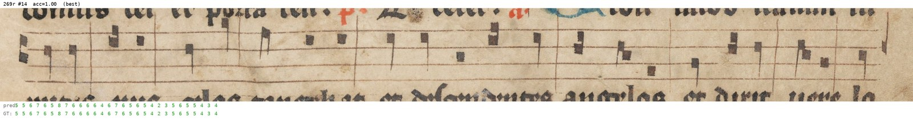
  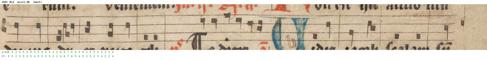
  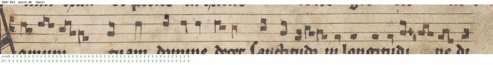
</p>
<p>
  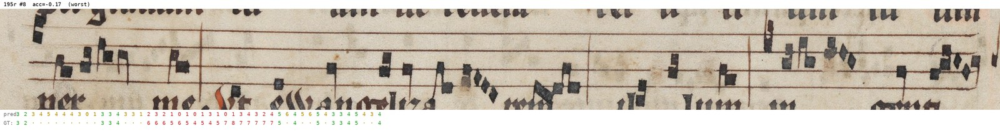
  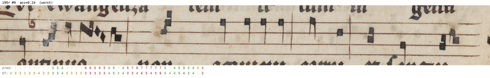
  
</p>

**`pname_seq`** — [best/worst](docs/predictions_pname/):

<p>
  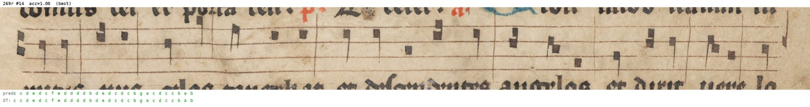
  
  
</p>
<p>
  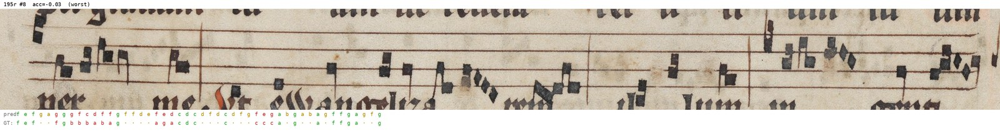
  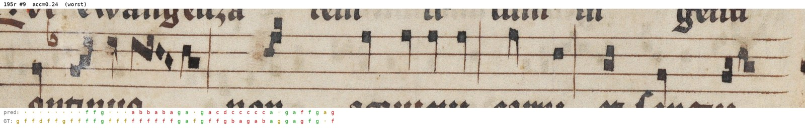
  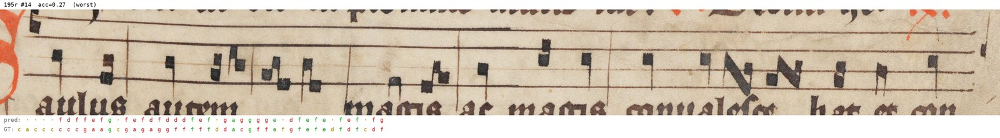
</p>

The full set of 5+5 for each scheme is in `docs/predictions_pos/` and
`docs/predictions_pname/`. The worst lines are the same handful of pages
for both schemes (e.g. `195r`) — an unusually large decorated-initial /
blank-staff region eats up most of the crop width there, leaving little
room for real notes relative to what the label expects. A genuine,
understandable failure mode, not a broken crop. Regenerate with:

```bash
python3 visualize.py --data_dir data --results_dir results_pos \
  --split test --n_best 5 --n_worst 5 --max_width 1600 --format jpg
```

## The YOLO detector

`yolo_weights/best.pt` (bundled in this repo, ~39MB) detects a
`music-blocks` class — the bounding box of each staff+text line region on a
page. It was trained (in a separate project, not included here) on 19
hand-labeled pages from roughly 10 other square-notation chant manuscripts
held at various libraries, and used **zero-shot** on the manuscript this
pipeline was developed on — it had never seen that manuscript's handwriting
during training. If you're pointing this pipeline at a very different
notation style or page layout, this detector may not transfer well; swap in
`--yolo_weights` any other checkpoint that localizes staff systems on the
page (any object detector framework works, as long as its output exposes
per-box class + xyxy coordinates the way `ultralytics` does — see
`build_dataset.py`'s YOLO-calling code if you need to adapt it).

Two examples of what that training data looked like (page images from other
manuscripts, kept anonymous here, with ground-truth boxes drawn on: blue =
`music-blocks`, the class `build_dataset.py` actually uses; orange =
`chant-text`, part of the original annotation scheme but unused by this
pipeline):

<p>
  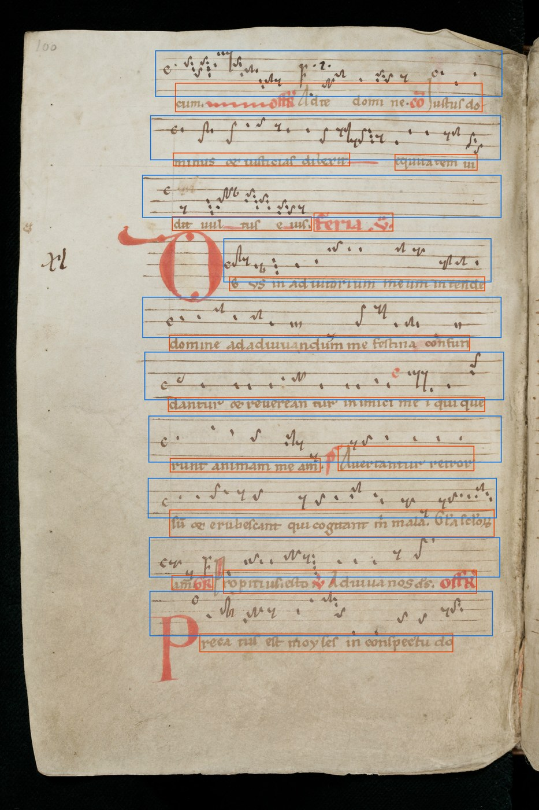
  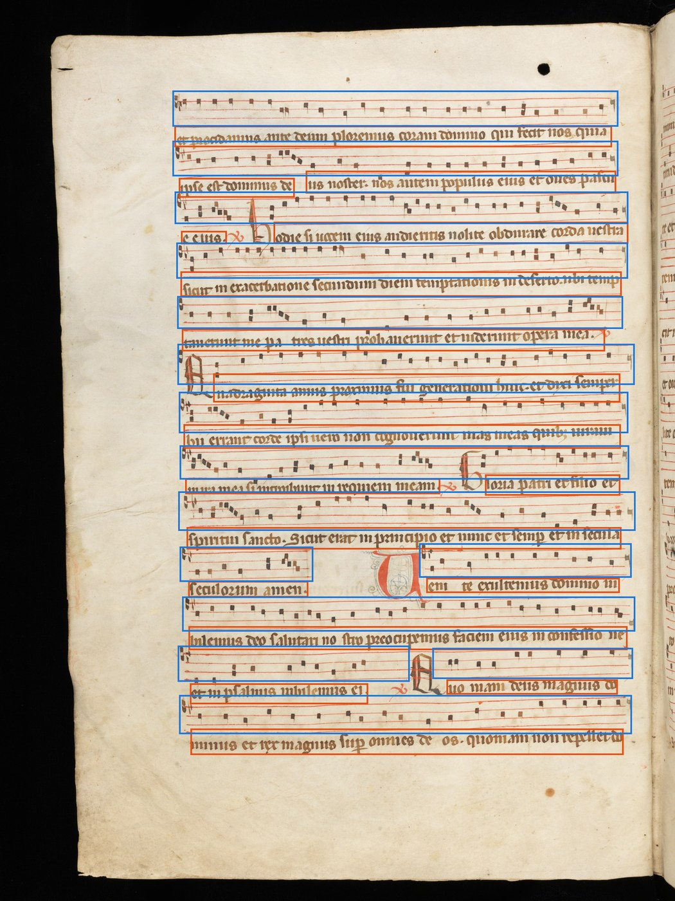
</p>

## Data quality: diagnosing crop↔label mismatches

This section records a specific data-quality investigation that shaped
`build_dataset.py`'s step 5 (the page-level fallback cutoff). It's kept
detailed here — beyond just stating the fix — because the diagnostic
process is the reusable part: anyone extending this pipeline to a new
manuscript is likely to run into some version of the same problem and will
need to re-run some version of this investigation, not just inherit the
fix.

### Why a crop can show the wrong content

Step 3 of the pipeline matches each detected YOLO box to its MEI system
purely by top-to-bottom order. This greedy, order-preserving match is
usually right, but it can go out of sync: if the detector under- or
over-detects on a page, or a system's expected-position estimate is thrown
off by a bad neighboring match, a system can end up paired with a
*different* system's box. The label (which comes straight from the MEI
document order, independent of the crop) then describes notes that aren't
actually pictured in its paired crop.

### How this was found

1. Started from a cheap, automatable proxy: for each line, compute what
   fraction of *its own* MEI notes' coordinates fall inside its assigned
   crop box ("coverage"). Lines with very low coverage were flagged as
   suspicious.
2. That proxy turned out to be noisy on its own — spot-checking a
   "coverage ≈ 0" line found a crop that was visually completely normal
   and correctly labeled. The reason: the coverage metric depends on the
   same individual MEI note coordinates that are sometimes wrong in this
   corpus, so a bad coverage score can reflect corrupted coordinate data
   rather than an actual bad crop.
3. The reliable signal came from manual visual auditing: rendering each
   flagged line's crop together with its MEI-derived label underneath and
   looking at it. This confirmed real cases — e.g. a crop showing mostly
   blank staff where the label expected dozens of notes, or a crop whose
   visible lyrics didn't match its label's neighboring-system content at
   all — alongside cases where a low coverage score was a false alarm.
4. Cross-referencing several confirmed mismatches against neighboring
   lines on the same page showed a pattern: once one system on a page
   fell back to the coordinate-based crop (no confident detector match),
   nearby systems' matches were also more likely to be off by one
   position. That's the basis for step 5: treat a fallback as a signal
   that the sequential matching may have lost sync for the rest of that
   page, not just for the one line that triggered it.

### What the fix does, and how to read its measured effect

Step 5 removes a real, identified source of label noise from *both* the
training data and the evaluation set. It is not primarily a lever for
pushing the headline accuracy number up — see
[Results](#results) for why the before/after test accuracy numbers aren't
directly comparable (the population of lines in the test set changes too).
When the resulting models were instead evaluated against the *original,
unfiltered* test set (the fairest like-for-like comparison available), the
accuracy difference was small. That's consistent with removing a real but
numerically minor amount of train/test noise in this particular corpus —
it doesn't mean the underlying mismatch problem wasn't real, or that
finding and fixing it wasn't worthwhile; it means this corpus's mismatch
rate wasn't large enough to move the aggregate metric much once measured
on equal footing. A corpus with a higher fallback rate, or a matching
algorithm with more room for error, could see a much bigger effect from
the same fix.

## Known limitations

- **The step-5 filter is a proxy, not a direct check.** It only catches
  mismatches that happen to correlate with a fallback event. A system that
  gets a nominally "detected" (non-fallback) match can still, in
  principle, be matched to the wrong neighboring system without ever
  triggering this filter — this was directly observed for a system that
  ends up matched to what geometrically looks like its neighbor's
  position while itself never falling back to a coordinate-based crop.
  By one audit, roughly 16% of lines showed this kind of mismatch before
  accounting for step 5 at all; CRNN+CTC training tolerates a minority of
  mislabeled lines reasonably well, but it's a real, only partially
  mitigated source of label noise.
- **A globally-optimal matching algorithm doesn't obviously help.** A
  DP/edit-distance-style global assignment (as opposed to the current
  greedy, order-preserving one) was tried and measurably *reduced* the
  geometric mismatch rate in a case-by-case audit, yet models trained on
  its output scored substantially worse than models trained on the greedy
  version's output — investigated at length (ruled out: random seed,
  image corruption, CTC feasibility, left/right crop coverage,
  environment/library drift) but never fully root-caused. This is the
  single biggest open question left by this line of work — see
  [Future directions](#future-directions).
- **No automated way yet to directly verify crop↔label correspondence.**
  Everything in [Data quality](#data-quality-diagnosing-croplabel-mismatches)
  is inference from proxies (coordinate coverage, fallback events) plus
  manual spot-checks, not a ground-truth-verified mismatch rate.
- **A minority of MEI note coordinates in this corpus are themselves
  unreliable** (don't correspond to real ink positions on the scan) — this
  affects any diagnostic that trusts individual note coordinates, not just
  the crop-matching step.
- **The `pos_seq` vs `pname_seq` comparison uses manuscript-specific
  data.** The general finding (relative position is easier to learn,
  especially in low-data regimes) is plausibly transferable to other
  square-notation corpora — the underlying argument (monotonic,
  octave-independent target) doesn't depend on this specific manuscript —
  but it hasn't been tested on one.

## Future directions

- **Train a manuscript-specific (or larger, more diverse) detector.** The
  bundled YOLO weights were trained zero-shot on ~10 other manuscripts and
  never saw the target manuscript's handwriting; a chunk of the fallback
  rate and matching noise likely traces back to detector misses/splits
  rather than the matching algorithm itself. Fine-tuning on a small
  hand-labeled sample of the target manuscript, or training on a larger
  and more varied set of source manuscripts, would likely reduce both the
  fallback rate and the amount of matching noise the
  [Data quality](#data-quality-diagnosing-croplabel-mismatches) section is
  about.
- **Test on manuscripts other than the one this was developed on.** Every
  number in this document — the `pos_seq` vs `pname_seq` comparison, the
  fallback filter's measured (small) effect, the mismatch rate itself —
  comes from a single manuscript's data and MEI encoding conventions.
  Whether these findings hold on a manuscript with different notation
  density, ink quality, page layout, or MEI annotation quality is
  untested. This matters most for the `pos_seq` finding: its claimed
  advantage is a property of the label scheme itself and should transfer,
  but that's a prediction, not something verified outside this one corpus.
- **Revisit the DP-matching mystery** (see Known limitations) with a
  cleaner experimental setup than what was tried here — e.g. controlling
  for exactly *which* lines differ between the greedy and DP outputs, and
  training on datasets that differ by only a handful of lines at a time to
  localize which specific matching decisions drive the accuracy gap.
